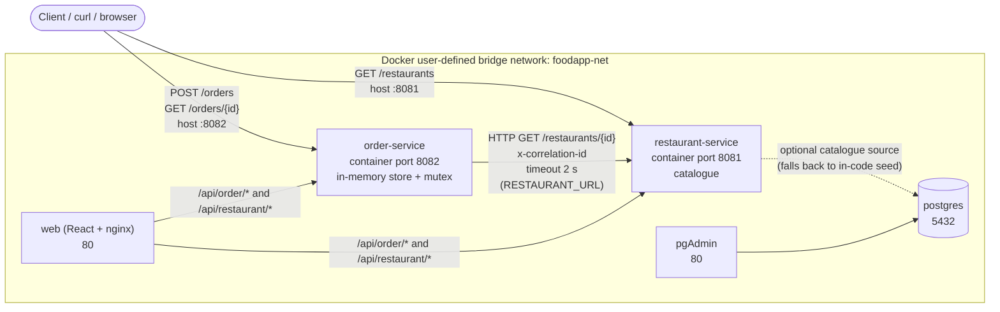
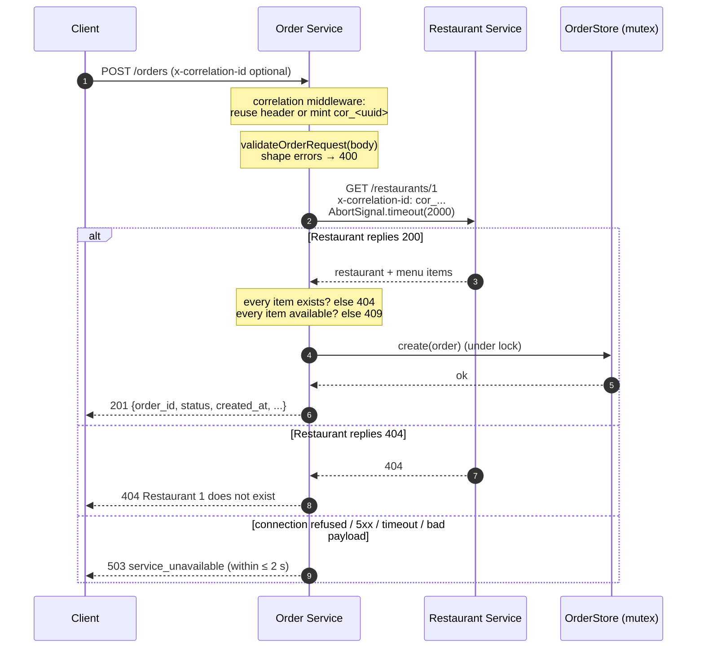

# Food Order Platform: Assignment 1, Detailed Guide

**Course:** CSE-4115L Distributed Systems Lab (2026)
**Assignment:** A1, two isolated services communicating reliably over HTTP

This document explains **what** was built, **how** it works internally, **how
to run it** (with Docker, with plain `docker run`, and without Docker), **how
the Dockerization works**, and **how each requirement of the assignment is
satisfied and verified**.

---

## Table of contents

1. [Scenario and goal](#1-scenario-and-goal)
2. [Requirements checklist](#2-requirements-checklist)
3. [Architecture](#3-architecture)
4. [How a request flows through the system](#4-how-a-request-flows-through-the-system)
5. [Restaurant Service](#5-restaurant-service)
6. [Order Service](#6-order-service)
7. [Validation and error mapping](#7-validation-and-error-mapping)
8. [Bounded timeouts and failure handling](#8-bounded-timeouts-and-failure-handling)
9. [Concurrency safety](#9-concurrency-safety)
10. [Health checks](#10-health-checks)
11. [Correlation IDs and structured logging](#11-correlation-ids-and-structured-logging)
12. [Dockerization in detail](#12-dockerization-in-detail)
13. [How to run](#13-how-to-run)
14. [API examples](#14-api-examples)
15. [Automated tests](#15-automated-tests)
16. [Verification experiments](#16-verification-experiments)
17. [Configuration reference](#17-configuration-reference)
18. [Repository layout](#18-repository-layout)
19. [Extras beyond the assignment](#19-extras-beyond-the-assignment)
20. [Troubleshooting](#20-troubleshooting)

---

## 1. Scenario and goal

Customers browse restaurants and create orders. The system is split into two
**independent services** that run in **separate containers**:

- **Restaurant Service** owns the catalogue (restaurants and menu items).
- **Order Service** creates and stores orders. Before accepting an order it
  must check that the restaurant and the items exist, and it must do that
  check **over HTTP** against the Restaurant Service, never by importing its
  code.

The emphasis of the assignment is on **distributed-systems behaviour**: a
real network boundary, predictable failures when the dependency is down,
bounded timeouts, concurrency safety, and traceability across services.

Implementation stack: **Node.js 20 + TypeScript 5 + Express 4**, with tests on
Node's built-in `node:test` runner. (The assignment says "without a local Go
installation". The point is that nothing needs to be installed on the host
except Docker. Here the TypeScript is compiled **inside** the Docker image, so
the host needs neither Node nor Go.)

---

## 2. Requirements checklist

Each requirement from the assignment page, where it is implemented, and how it
is verified:

| # | Requirement | Implementation | Verified by |
|---|---|---|---|
| 1 | Restaurant `GET /restaurants` | [services/restaurant/src/app.ts](services/restaurant/src/app.ts) | Restaurant test T1 |
| 2 | Restaurant `GET /restaurants/{id}` | same file | Restaurant tests T2, T3, T4 |
| 3 | Seed ≥ 3 restaurants and ≥ 6 menu items | [seed.ts](services/restaurant/src/seed.ts) and [db/init.sql](db/init.sql): **4 restaurants, 12 items** | Restaurant test T1 |
| 4 | Order `POST /orders` and `GET /orders/{id}` | [services/order/src/app.ts](services/order/src/app.ts) | Order tests T1, T2, T9 |
| 5 | Validate restaurant and items via an **HTTP call**, no direct code calls | [restaurantClient.ts](services/order/src/restaurantClient.ts) uses `fetch(RESTAURANT_URL + "/restaurants/{id}")`. The two packages share no code. | Order tests T3, T4; outage tests |
| 6 | Generate unique `order_id` and `correlation_id` | [types.ts](services/order/src/types.ts): `ord_<UUIDv4>` and `cor_<UUIDv4>` | Order test T11, concurrency T13 |
| 7 | Response JSON contains `order_id`, `status`, `created_at` | `POST /orders` 201 body | Order test T1 |
| 8 | In-memory store behind a mutex | [orderStore.ts](services/order/src/orderStore.ts) and [mutex.ts](services/order/src/mutex.ts) | Concurrency tests T13, T14 |
| 9 | Reject bad quantities, missing fields, nonexistent restaurant/item | [validation.ts](services/order/src/validation.ts) plus the downstream checks in `app.ts` | Order tests T3 to T8 |
| 10 | **400** malformed, **404** missing, **503** dependency unavailable | `app.ts` → `mapLookupFailureToStatus` | Order tests T3 to T8; outage tests T15 to T17 |
| 11 | Short configured timeout on the downstream call | `AbortSignal.timeout(RESTAURANT_TIMEOUT_MS)`, default 2000 ms | Outage test T16; Experiment 2, step 5 |
| 12 | Handle ≥ 20 concurrent requests without corrupting state | Mutex store and UUID ids | Concurrency test T13; `scripts/concurrency-check.sh` |
| 13 | `/healthz` on both services | both `app.ts` files | Restaurant T5, Order T10; Docker `HEALTHCHECK` |
| 14 | Propagate correlation IDs in requests and logs | `x-correlation-id` middleware in both services, forwarded on the outbound call, included in every log line | Restaurant T6; logs in `docs/logs/` |
| 15 | Separate `services/order` and `services/restaurant`, each with its own entrypoint and README | `src/index.ts` and `README.md` in each folder | n/a |
| 16 | One Dockerfile per service | [services/restaurant/Dockerfile](services/restaurant/Dockerfile), [services/order/Dockerfile](services/order/Dockerfile) | `docker compose up --build` |
| 17 | Restaurant location from `RESTAURANT_URL` env var | [services/order/src/index.ts](services/order/src/index.ts) | `GET /healthz` shows the URL in use |
| 18 | Both containers on a **user-defined Docker network**, different ports | `foodapp-net` bridge network; Restaurant on **8081**, Order on **8082** | `docker network inspect foodapp-net` |
| 19 | 20 concurrent POSTs → 20 unique IDs | n/a | Experiment 1 |
| 20 | Stop Restaurant → bounded error | n/a | Experiment 2 |
| 21 | Start containers without a local toolchain and retrieve orders | Multi-stage Docker builds | Experiment 3 |
| 22 | ≥ 6 automated tests (success, validation, concurrency, unavailable dependency) | **24 tests** | `npm test` |
| 23 | Example logs from the outage experiment | [docs/logs/outage-experiment.log](docs/logs/outage-experiment.log) and transcript | n/a |
| 24 | README and API examples | this file, [README.md](README.md), [docs/API_CONTRACT.md](docs/API_CONTRACT.md) | n/a |

**Result of the latest verification run (2026-11-18):** all 24 automated tests
pass. Both experiment scripts exit 0. All status codes were checked manually
against the running containers.

---

## 3. Architecture



The **core of the assignment** is the two boxes `order-service` and
`restaurant-service` and the HTTP arrow between them. PostgreSQL, pgAdmin and
the React console are optional extras (see [§19](#19-extras-beyond-the-assignment)).
The two required services work without them.

Key design points:

- **Isolation.** Each service is its own npm package with its own
  `package.json`, `tsconfig.json`, dependencies, Dockerfile, entrypoint
  (`src/index.ts`) and README. Neither imports anything from the other.
- **HTTP boundary.** The only coupling is the JSON contract of
  `GET /restaurants/{id}`.
- **Service discovery by DNS.** Inside the Docker network the Order Service
  reaches the Restaurant Service as `http://restaurant-service:8081`. Docker's
  embedded DNS resolves the service name. That value is passed through the
  `RESTAURANT_URL` environment variable and is never hard-coded.

---

## 4. How a request flows through the system

`POST /orders` with body
`{"restaurant_id":1,"items":[{"menu_item_id":101,"quantity":2}]}`:



The order is written to the store **only after** the downstream lookup
succeeds, so a failed request never leaves a partial order behind (test T18).

---

## 5. Restaurant Service

Folder: [services/restaurant/](services/restaurant/) · Port **8081**

| File | Responsibility |
|---|---|
| `src/index.ts` | Entrypoint: picks the catalogue source, starts Express, graceful shutdown on SIGTERM/SIGINT |
| `src/app.ts` | Routes, correlation-ID middleware, request logging, JSON error envelope |
| `src/catalogue.ts` | `MemoryCatalogue` (in-code seed) and `PostgresCatalogue`, plus fallback selection |
| `src/seed.ts` | The seed data: 4 restaurants × 3 items = 12 menu items |
| `src/types.ts` | Response shapes (`RestaurantSummary`) |
| `src/logger.ts` | One-JSON-object-per-line logger |

Endpoints:

| Method | Path | Success | Errors |
|---|---|---|---|
| GET | `/restaurants` | 200 `{count, restaurants:[summary…]}` | none |
| GET | `/restaurants/{id}` | 200 restaurant **with `items`** | 400 non-numeric id, 404 unknown |
| GET | `/restaurants/{id}/items` | 200 (convenience for the UI) | 400, 404 |
| GET | `/healthz` | 200 `{status:"ok", catalogue_source, …}` | none |

**Catalogue source.** If `DATABASE_URL` is set and PostgreSQL answers at
startup, the catalogue is read from the `restaurants` / `menu_items` tables.
Otherwise the service logs a warning and serves the identical in-code seed.
That means the Restaurant container also works **completely on its own**
(`catalogue_source: "memory"`), which is what you get with a plain
`docker run` and no database.

Seed data (identical in `seed.ts` and `db/init.sql`):

| id | Restaurant | Items (id, name, price in poisha) |
|---|---|---|
| 1 | Bella Pizza Napoli | 101 Margherita 950 · 102 Diavola 1250 · 103 Quattro Formaggi 1450 (**unavailable**) |
| 2 | Saffron Spice House | 201 Chicken Biryani 320 · 202 Beef Kala Bhuna 420 · 203 Vegetable Khichuri 260 |
| 3 | Tokyo Ramen Bar | 301 Tonkotsu Ramen 780 · 302 Spicy Miso Ramen 820 · 303 Chicken Gyoza 450 |
| 4 | Green Bowl Kitchen | 401 Quinoa Power Bowl 550 · 402 Falafel Wrap 390 · 403 Green Juice 280 |

---

## 6. Order Service

Folder: [services/order/](services/order/) · Port **8082**

| File | Responsibility |
|---|---|
| `src/index.ts` | Entrypoint: reads `RESTAURANT_URL` and `RESTAURANT_TIMEOUT_MS`, builds the client and store, starts Express |
| `src/app.ts` | Routes, the order-creation flow, failure → status mapping |
| `src/validation.ts` | Pure request-shape validation (all 400 cases) |
| `src/restaurantClient.ts` | The **only** place that talks to the Restaurant Service: `fetch` with timeout, plus failure classification |
| `src/orderStore.ts` | `Map<order_id, Order>`; every operation runs inside the mutex |
| `src/mutex.ts` | A small FIFO async mutex |
| `src/types.ts` | `Order` type, `generateOrderId()`, `generateCorrelationId()` |
| `src/logger.ts` | JSON line logger (same format as the Restaurant Service) |

Endpoints:

| Method | Path | Success | Errors |
|---|---|---|---|
| POST | `/orders` | **201** `{order_id, status, created_at, correlation_id, restaurant_id, items, total_cents, currency}` | 400, 404, 409, 503 |
| GET | `/orders/{id}` | 200 full order | 404 |
| GET | `/orders` | 200 list (convenience for the UI) | none |
| GET | `/healthz` | 200 `{status, restaurant_service_url, restaurant_timeout_ms, …}` | none |

**Persistence.** As the assignment specifies, A1 orders live **in memory**, so
restarting the Order container empties the store. A2 moves them to PostgreSQL.
The `orders` / `order_items` tables already exist in `db/init.sql` for that.

---

## 7. Validation and error mapping

Validation happens in two layers.

**Layer 1: request shape** (`validation.ts`, no network) → **400**

| Input | Response |
|---|---|
| Body is not valid JSON | 400 `Request body is not valid JSON` |
| Body is not a JSON object | 400 `Request body must be a JSON object` |
| `restaurant_id` missing / not a positive integer | 400 |
| `items` missing / not an array / empty / more than 50 entries | 400 |
| `items[i].menu_item_id` missing / not a positive integer | 400 |
| `items[i].quantity` missing / not an integer / ≤ 0 / > 99 | 400 |

**Layer 2: existence, checked through the Restaurant Service over HTTP**

| Situation | Order Service returns |
|---|---|
| Restaurant Service answers 404 | **404** `Restaurant N does not exist` |
| Restaurant exists but an item id is not on its menu | **404** `Menu item X does not exist for restaurant N` |
| Item exists but `available=false` | **409** `item_unavailable` (an extra, more precise case) |
| Restaurant Service answers another 4xx | 400 |
| Restaurant Service answers 5xx | **503** |
| Connection refused / DNS failure | **503** |
| No answer within `RESTAURANT_TIMEOUT_MS` | **503** |
| Answer is not the expected JSON | **503** |

All errors share one envelope:

```json
{
  "error": "bad_request | not_found | item_unavailable | service_unavailable | internal_error",
  "message": "human readable",
  "field": "items[0].quantity",
  "correlation_id": "cor_..."
}
```

(`field` appears only on validation errors.)

---

## 8. Bounded timeouts and failure handling

In `restaurantClient.ts`:

```ts
response = await fetch(`${this.baseUrl}/restaurants/${restaurantId}`, {
  headers: { accept: 'application/json', 'x-correlation-id': correlationId },
  signal: AbortSignal.timeout(this.timeoutMs),   // RESTAURANT_TIMEOUT_MS, default 2000
});
```

- **The dependency is stopped.** The TCP connection is refused immediately, so
  the result is a 503 in a few hundred milliseconds.
- **The dependency hangs** (accepts the connection but never answers).
  `AbortSignal.timeout` aborts the request after exactly
  `RESTAURANT_TIMEOUT_MS`, so the result is a 503 after about 2 s.
- There are no retries and no unbounded waits anywhere in the request path.
  The worst-case latency of `POST /orders` is about the timeout.
- Each failure is classified (`not_found`, `bad_request`, `unavailable`,
  `timeout`, `invalid_response`) and logged with the correlation ID and
  duration. It is then mapped to a status code by `mapLookupFailureToStatus`.
- **Recovery is automatic.** The client keeps no sticky state, so once the
  Restaurant Service comes back the next order succeeds without restarting the
  Order Service.

---

## 9. Concurrency safety

- **Unique IDs by construction.** `order_id = "ord_" + crypto.randomUUID()`.
  There is no shared counter that could race.
- **Mutex-protected store.** `OrderStore.create/get/list/count` all run inside
  `mutex.runExclusive(...)`. The mutex is a FIFO queue of waiters, and the
  release hands ownership directly to the next waiter, so there is no lock
  stealing.
- **Why a mutex in Node?** Node runs JavaScript on one thread, so a single
  `Map.set` cannot interleave. The assignment, however, asks explicitly for a
  mutex or a concurrency-safe map. More importantly, the mutex keeps the store
  correct if an `await` is ever added inside the critical section, which will
  happen when A2 replaces the map with database calls.
- **Proof:** 20 concurrent `POST /orders` give 20 distinct IDs, totals equal
  `Σ unit_price × quantity`, and all 20 are retrievable (test T13 and
  Experiment 1). 20 concurrent `GET`s each return their own order (T14).

---

## 10. Health checks

| Service | Endpoint | Example response |
|---|---|---|
| Restaurant | `GET :8081/healthz` | `{"status":"ok","service":"restaurant-service","catalogue_source":"postgres","uptime_s":18,…}` |
| Order | `GET :8082/healthz` | `{"status":"ok","service":"order-service","restaurant_service_url":"http://restaurant-service:8081","restaurant_timeout_ms":2000,…}` |

Docker uses these endpoints too: each Dockerfile declares a `HEALTHCHECK` that
calls `/healthz` every 10 s, and `docker compose ps` shows `(healthy)`. Compose
starts `order-service` only after `restaurant-service` reports healthy.

`/healthz` is a **liveness** check of the service itself. The Order Service
stays healthy when the Restaurant Service is down: it is still able to answer,
and answers order requests with 503.

---

## 11. Correlation IDs and structured logging

1. Each service has middleware that reads the `x-correlation-id` request
   header. If the header is absent, the service mints `cor_<uuid>`.
2. The ID is stored in `res.locals.correlationId`, echoed in the
   `x-correlation-id` **response header**, and included in every error body.
3. The Order Service **forwards the same header** on its outbound call to the
   Restaurant Service.
4. Both services log one JSON object per line, and every request-related line
   carries `correlation_id`.

So a single `grep` follows one user action across both containers:

```bash
curl -s -X POST localhost:8082/orders -H 'content-type: application/json' \
     -H 'x-correlation-id: cor_readme_demo' \
     -d '{"restaurant_id":1,"items":[{"menu_item_id":101,"quantity":2}]}'

docker compose logs | grep cor_readme_demo
```

```text
foodapp-restaurant | {"service":"restaurant-service","message":"http_request","method":"GET","path":"/restaurants/1","status":200,"duration_ms":2,"correlation_id":"cor_readme_demo"}
foodapp-order      | {"service":"order-service","message":"restaurant_call_ok","url":"http://restaurant-service:8081/restaurants/1","correlation_id":"cor_readme_demo","status":200,"duration_ms":5}
foodapp-order      | {"service":"order-service","message":"order_created","order_id":"ord_522361c9-…","correlation_id":"cor_readme_demo","total_cents":1900}
foodapp-order      | {"service":"order-service","message":"http_request","method":"POST","path":"/orders","status":201,"correlation_id":"cor_readme_demo"}
```

The order also stores the `correlation_id` it was created under, so the ID is
returned by `GET /orders/{id}` as well.

---

## 12. Dockerization in detail

### 12.1 One Dockerfile per service (multi-stage)

Both [services/restaurant/Dockerfile](services/restaurant/Dockerfile) and
[services/order/Dockerfile](services/order/Dockerfile) follow the same pattern:

```dockerfile
# ---- stage 1: builder -------------------------------------------------
FROM node:20-alpine AS builder
WORKDIR /app
COPY package*.json ./
RUN npm install                       # includes TypeScript (dev dependency)
COPY tsconfig.json ./
COPY src ./src
COPY test ./test
RUN node node_modules/typescript/bin/tsc -p tsconfig.json   # TS → dist/

# ---- stage 2: runtime -------------------------------------------------
FROM node:20-alpine AS runtime
WORKDIR /app
ENV NODE_ENV=production
COPY package*.json ./
RUN npm install --omit=dev            # only express (+ pg for restaurant)
COPY --from=builder /app/dist/src ./dist/src   # compiled JS only
USER node                             # do not run as root
ENV PORT=8082 RESTAURANT_URL=http://restaurant-service:8081 RESTAURANT_TIMEOUT_MS=2000
EXPOSE 8082
HEALTHCHECK --interval=10s --timeout=3s --start-period=5s --retries=5 \
  CMD node -e "fetch('http://127.0.0.1:'+(process.env.PORT||8082)+'/healthz').then(r=>process.exit(r.ok?0:1)).catch(()=>process.exit(1))"
CMD ["node", "dist/src/index.js"]
```

What this achieves:

| Feature | Why |
|---|---|
| **Compilation happens inside Docker** | The host needs only Docker, with no Node, TypeScript or Go installed. This is the "reproducible startup" criterion. |
| **Multi-stage** | The final image contains no TypeScript compiler, no tests and no dev dependencies, so it is smaller and has less attack surface. |
| `.dockerignore` | Excludes host `node_modules`, `dist`, `.env` and logs from the build context, so the build is clean and reproducible. |
| `USER node` | The process runs unprivileged. |
| `ENV` defaults + `EXPOSE` | The image documents its own port and config. Every value can be overridden at `docker run` / compose time. |
| `HEALTHCHECK` | Docker probes `/healthz` itself (Node 20's built-in `fetch`, so no `curl` is needed in the image). |
| Graceful shutdown | `index.ts` handles `SIGTERM` (sent by `docker stop`), closes the server and exits within 5 s. |

The `ENV RESTAURANT_URL` line in the Order image is only a **default**. The
code reads it from `process.env`, and compose sets it explicitly. Nothing in
`src/` contains the Restaurant hostname.

### 12.2 docker-compose.yml

[docker-compose.yml](docker-compose.yml) describes the whole stack. The parts
that matter for A1:

```yaml
services:
  restaurant-service:
    build: ./services/restaurant
    ports: ["8081:8081"]              # host:container
    networks: [foodapp-net]

  order-service:
    build: ./services/order
    environment:
      RESTAURANT_URL: ${RESTAURANT_URL:-http://restaurant-service:8081}
      RESTAURANT_TIMEOUT_MS: ${RESTAURANT_TIMEOUT_MS:-2000}
    depends_on:
      restaurant-service:
        condition: service_healthy    # waits for the HEALTHCHECK
    ports: ["8082:8082"]
    networks: [foodapp-net]

networks:
  foodapp-net:                        # user-defined network
    name: foodapp-net
    driver: bridge
```

- **User-defined bridge network (`foodapp-net`).** Docker's default bridge
  network has **no DNS between containers**. A user-defined network has
  embedded DNS, so `restaurant-service` resolves to the Restaurant container's
  IP. That is why `RESTAURANT_URL=http://restaurant-service:8081` works.
- **`localhost` would be wrong.** Inside the Order container, `localhost` is
  the Order container itself. That is why the URL must be configurable and is
  set to the service name.
- **Different ports.** Restaurant listens on 8081, Order on 8082. Both are
  published to the host on the same numbers.
- **Startup order.** `depends_on: condition: service_healthy` makes compose
  wait until the Restaurant `HEALTHCHECK` passes before starting Order.
- **Configuration via `.env`.** Compose reads `.env` automatically, and every
  `${VAR:-default}` can be overridden there (see `.env.example`).
- `restart: unless-stopped` restarts crashed containers, but leaves alone a
  container you stopped manually with `docker compose stop` (which the outage
  experiment relies on).

Verify the network:

```bash
docker network inspect foodapp-net --format '{{.Driver}}: {{range .Containers}}{{.Name}} {{end}}'
# bridge: foodapp-web foodapp-postgres foodapp-order foodapp-pgadmin foodapp-restaurant
```

### 12.3 Without compose: plain `docker run` on a user-defined network

This shows that the two services really are independent images. No database
is needed:

```bash
docker build -t foodapp/restaurant-service:1.0.0 services/restaurant
docker build -t foodapp/order-service:1.0.0      services/order

docker network create a1-net

docker run -d --name restaurant-a1 --network a1-net -p 8081:8081 \
  foodapp/restaurant-service:1.0.0

docker run -d --name order-a1 --network a1-net -p 8082:8082 \
  -e RESTAURANT_URL=http://restaurant-a1:8081 \
  -e RESTAURANT_TIMEOUT_MS=2000 \
  foodapp/order-service:1.0.0

curl localhost:8081/healthz      # "catalogue_source":"memory"
curl -X POST localhost:8082/orders -H 'content-type: application/json' \
  -d '{"restaurant_id":3,"items":[{"menu_item_id":301,"quantity":1}]}'

# clean up
docker rm -f restaurant-a1 order-a1 && docker network rm a1-net
```

(If the compose stack is already using ports 8081/8082, publish on other host
ports, e.g. `-p 9081:8081 -p 9082:8082`. The container ports stay the same.)

---

## 13. How to run

### 13.1 Prerequisites

- Docker Engine or Docker Desktop with Compose v2 (`docker compose version`)
- For running the tests or the services outside Docker: Node.js ≥ 20
- `curl` and `bash` for the experiment scripts

### 13.2 Run everything with Docker Compose (recommended)

```bash
cp .env.example .env              # optional: compose has defaults for everything
docker compose up -d --build      # build images and start containers
docker compose ps                 # wait for (healthy)
```

| URL | What |
|---|---|
| http://localhost:8081/restaurants | Restaurant Service |
| http://localhost:8082/orders | Order Service |
| http://localhost:8081/healthz, http://localhost:8082/healthz | Health |
| http://localhost:8080 | React admin console (extra) |
| http://localhost:5050 | pgAdmin (extra) |

Useful commands:

```bash
docker compose logs -f order-service restaurant-service   # follow logs
docker compose stop restaurant-service                    # simulate outage
docker compose start restaurant-service                   # recover
docker compose up -d --build --force-recreate             # rebuild after code changes
docker compose down                                       # stop and remove containers
docker compose down -v                                    # ...and the DB volume
```

To start **only the two A1 services** (plus Postgres, which the Restaurant
Service can use):

```bash
docker compose up -d --build restaurant-service order-service
```

### 13.3 Run without Docker (Node 20+)

```bash
# terminal 1
cd services/restaurant && npm install && npm run build
PORT=8081 node dist/src/index.js            # no DATABASE_URL → in-memory seed

# terminal 2
cd services/order && npm install && npm run build
PORT=8082 RESTAURANT_URL=http://localhost:8081 RESTAURANT_TIMEOUT_MS=2000 node dist/src/index.js
```

> The repository path contains a colon (`CSE-4115L:`), which breaks npm's
> `.bin` PATH handling. That is why the `build` / `test` scripts call
> `node node_modules/typescript/bin/tsc` directly instead of `tsc`.

---

## 14. API examples

### List restaurants

```bash
curl -s localhost:8081/restaurants
```
```json
{"count":4,"restaurants":[{"id":1,"name":"Bella Pizza Napoli","cuisine":"Italian","address":"12 Harbour Road, Dhaka","rating":4.6,"image_url":"…","item_count":3}, …]}
```

### Get one restaurant (with menu)

```bash
curl -s localhost:8081/restaurants/1
```
```json
{"id":1,"name":"Bella Pizza Napoli", …,"items":[{"id":101,"name":"Margherita","price_cents":950,"currency":"BDT","description":"…","available":true}, …]}
```

### Create an order → 201

```bash
curl -s -X POST localhost:8082/orders \
  -H 'content-type: application/json' \
  -H 'x-correlation-id: cor_readme_demo' \
  -d '{"restaurant_id":1,"items":[{"menu_item_id":101,"quantity":2}]}'
```
```json
{
  "order_id": "ord_522361c9-2b5d-4b06-8a4d-f3548d64ccf0",
  "status": "CONFIRMED",
  "created_at": "2026-11-18T12:25:54.140Z",
  "correlation_id": "cor_readme_demo",
  "restaurant_id": 1,
  "items": [{"menu_item_id":101,"quantity":2,"unit_price_cents":950,"name":"Margherita"}],
  "total_cents": 1900,
  "currency": "BDT"
}
```

### Fetch the order → 200

```bash
curl -s localhost:8082/orders/ord_522361c9-2b5d-4b06-8a4d-f3548d64ccf0
```

### Error cases (real responses from the running containers)

| Request body / call | Status | Body |
|---|---|---|
| `{"items":[{"menu_item_id":101,"quantity":1}]}` | 400 | `Missing required field: restaurant_id` |
| `…"quantity":0…` | 400 | `items[0].quantity must be greater than 0` |
| `…"quantity":"2"…` | 400 | `items[0].quantity must be an integer` |
| `{bad json` | 400 | `Request body is not valid JSON` |
| `{"restaurant_id":99,…}` | 404 | `Restaurant 99 does not exist` |
| `…"menu_item_id":999…` | 404 | `Menu item 999 does not exist for restaurant 1` |
| `…"menu_item_id":103…` | 409 | `Menu item 103 is currently unavailable` |
| `GET /orders/nope` | 404 | `Order nope does not exist` |
| any valid order, Restaurant **stopped** | 503 | `Restaurant Service is unreachable: fetch failed` |
| any valid order, Restaurant **hanging** | 503 | `Restaurant Service did not respond within 2000ms` |

The full contract is in [docs/API_CONTRACT.md](docs/API_CONTRACT.md).

---

## 15. Automated tests

```bash
npm test                                    # both services
npm --prefix services/restaurant test       # 6 tests
npm --prefix services/order test            # 18 tests
```

Tests use Node's built-in runner. Each test starts the real Express app on a
random port and talks to it over HTTP. The outage tests start **fake
Restaurant servers** (one that refuses, one that hangs, one that returns
500/422), so the network failure paths are exercised for real, without Docker.

| Suite | # | Test | Category |
|---|---|---|---|
| restaurant.test.ts | T1 | `GET /restaurants` returns the seeded catalogue | success |
| | T2 | `GET /restaurants/:id` returns a restaurant with menu items | success |
| | T3 | unknown restaurant → 404 | validation |
| | T4 | non-numeric id → 400 | validation |
| | T5 | `/healthz` reports status and catalogue source | health |
| | T6 | correlation ID is minted, and an inbound one is propagated | tracing |
| order.test.ts | T1 | `POST /orders` → 201 with `order_id`, `status`, `created_at` | success |
| | T2 | `GET /orders/:id` returns the created order | success |
| | T3 | unknown restaurant → 404 | validation |
| | T4 | unknown menu item → 404 | validation |
| | T5 | missing `restaurant_id` → 400 | validation |
| | T6 | invalid quantity → 400 | validation |
| | T7 | missing `items` → 400 | validation |
| | T8 | malformed JSON → 400 (with correlation ID) | validation |
| | T9 | unknown order → 404 | validation |
| | T10 | `/healthz` | health |
| | T11 | every order gets unique `order_id` and a `correlation_id` | success |
| | T12 | unavailable item → 409 | validation |
| concurrency.test.ts | T13 | **20 concurrent POSTs → 20 unique IDs, intact totals** | concurrency |
| | T14 | 20 concurrent GETs each return their own order | concurrency |
| outage.test.ts | T15 | Restaurant down (connection refused) → 503 quickly | unavailable dependency |
| | T16 | Restaurant hangs → 503 **within the configured timeout** | unavailable dependency |
| | T17 | downstream 500 → 503, downstream 4xx → 400 | unavailable dependency |
| | T18 | no order is persisted when the lookup fails | unavailable dependency |

Latest run: `# tests 6 # pass 6 # fail 0` and `# tests 18 # pass 18 # fail 0`.

---

## 16. Verification experiments

Both scripts run against the compose stack (`docker compose up -d --build`
first). Full write-up: [docs/EXPERIMENTS.md](docs/EXPERIMENTS.md).

### Experiment 1: 20 concurrent POSTs

```bash
bash scripts/concurrency-check.sh            # optional args: [url] [count]
```

The script starts 20 `curl` processes in the background at the same time,
each with a different restaurant, item, quantity and correlation ID. It then
checks status codes, ID uniqueness, totals, status, and that every order can
be fetched again:

```text
--- HTTP status codes ---
     20 201
orders created : 20
unique ids     : 20
corrupt orders : 0
RESULT         : PASS - every order has a unique id and intact state
RESULT         : PASS - all 20 orders fetched successfully
```

### Experiment 2: outage (stopped and hanging dependency)

```bash
bash scripts/outage-check.sh
```

Steps: baseline order → `docker compose stop restaurant-service` → order →
start → `docker compose pause restaurant-service` (simulates a hang) → order →
unpause → recovery order → print the Order Service log lines.

```text
--- Step 3: submit an order while the dependency is down ---
HTTP 503 in 354ms (curl timeout was 30s)
{"error":"service_unavailable","message":"Restaurant Service is unreachable: fetch failed","correlation_id":"cor_outage_demo"}

--- Step 5: Restaurant HANGS (container paused, TCP accepted but no reply) ---
HTTP 503 in 2014ms (bounded by RESTAURANT_TIMEOUT_MS)
{"error":"service_unavailable","message":"Restaurant Service did not respond within 2000ms","correlation_id":"cor_hang_demo"}

--- Step 6: recovery ---
recovered: HTTP 201 in 0.005850s
```

**Example logs from the outage experiment**
([docs/logs/outage-experiment.log](docs/logs/outage-experiment.log)):

```json
{"ts":"2026-11-18T12:27:18.874Z","level":"error","service":"order-service","message":"restaurant_call_failed","url":"http://restaurant-service:8081/restaurants/1","correlation_id":"cor_outage_demo","reason":"network_error","error":"fetch failed","duration_ms":341}
{"ts":"2026-11-18T12:27:18.874Z","level":"warn","service":"order-service","message":"order_rejected_dependency","correlation_id":"cor_outage_demo","restaurant_id":1,"reason":"Restaurant Service is unreachable: fetch failed","kind":"unavailable","mapped_status":503}
{"ts":"2026-11-18T12:27:18.875Z","level":"info","service":"order-service","message":"http_request","method":"POST","path":"/orders","status":503,"duration_ms":343,"correlation_id":"cor_outage_demo"}
{"ts":"2026-11-18T12:27:27.238Z","level":"error","service":"order-service","message":"restaurant_call_failed","url":"http://restaurant-service:8081/restaurants/1","correlation_id":"cor_hang_demo","reason":"timeout","error":"The operation was aborted due to timeout","duration_ms":2002}
{"ts":"2026-11-18T12:27:27.238Z","level":"warn","service":"order-service","message":"order_rejected_dependency","correlation_id":"cor_hang_demo","restaurant_id":1,"reason":"Restaurant Service did not respond within 2000ms","kind":"timeout","mapped_status":503}
{"ts":"2026-11-18T12:27:27.239Z","level":"info","service":"order-service","message":"http_request","method":"POST","path":"/orders","status":503,"duration_ms":2003,"correlation_id":"cor_hang_demo"}
```

| Failure mode | Detected as | HTTP | Latency |
|---|---|---|---|
| Container stopped | `network_error` | 503 | ~150 to 350 ms |
| Container paused (hang) | `timeout` | 503 | ~2000 ms = `RESTAURANT_TIMEOUT_MS` |

### Experiment 3: start containers with no local toolchain and retrieve orders

On a machine with only Docker installed:

```bash
docker compose up -d --build
ID=$(curl -s -X POST localhost:8082/orders -H 'content-type: application/json' \
      -d '{"restaurant_id":2,"items":[{"menu_item_id":201,"quantity":1}]}' \
      | sed -E 's/.*"order_id":"([^"]+)".*/\1/')
curl -s localhost:8082/orders/$ID        # 200 with the stored order
```

All compilation happens in the `builder` stage of each Dockerfile.

Saved artefacts in [docs/logs/](docs/logs/):
`outage-experiment.log`, `outage-experiment-transcript.txt`,
`concurrency-experiment-transcript.txt`, `order-service-sample.log`,
`restaurant-service-sample.log`.

---

## 17. Configuration reference

| Variable | Service | Default | Meaning |
|---|---|---|---|
| `RESTAURANT_URL` | order | `http://restaurant-service:8081` in Docker, `http://localhost:8081` locally | Base URL of the Restaurant Service (**not hard-coded**) |
| `RESTAURANT_TIMEOUT_MS` | order | `2000` | Timeout of the downstream call |
| `PORT` / `ORDER_PORT` | order | `8082` | Listen port |
| `PORT` / `RESTAURANT_PORT` | restaurant | `8081` | Listen port |
| `HOST` | both | `0.0.0.0` | Bind address (must be 0.0.0.0 in a container) |
| `LOG_LEVEL` | both | `info` | `debug` / `info` / `warn` / `error` |
| `DATABASE_URL` | restaurant | unset (compose sets it) | Optional PostgreSQL catalogue source |
| `POSTGRES_*`, `POSTGRES_HOST_PORT` | postgres | `foodapp` / `5433` | Extra: database container |
| `WEB_PORT` | web | `8080` | Extra: admin console host port |

Example: make the timeout shorter and watch the hang case fail faster:

```bash
RESTAURANT_TIMEOUT_MS=500 docker compose up -d order-service
curl -s localhost:8082/healthz      # "restaurant_timeout_ms":500
```

---

## 18. Repository layout

```text
.
├── README.md                 # short overview
├── README_DETAILED.md        # this document
├── docker-compose.yml        # full stack + user-defined network foodapp-net
├── .env.example
├── services/
│   ├── restaurant/           # independent package
│   │   ├── Dockerfile  .dockerignore  README.md  package.json  tsconfig.json
│   │   ├── src/  index.ts app.ts catalogue.ts seed.ts types.ts logger.ts
│   │   └── test/ restaurant.test.ts
│   └── order/                # independent package
│       ├── Dockerfile  .dockerignore  README.md  package.json  tsconfig.json
│       ├── src/  index.ts app.ts restaurantClient.ts orderStore.ts mutex.ts validation.ts types.ts logger.ts
│       └── test/ order.test.ts concurrency.test.ts outage.test.ts
├── scripts/
│   ├── concurrency-check.sh  # Experiment 1
│   └── outage-check.sh       # Experiment 2
├── docs/
│   ├── API_CONTRACT.md  EXPERIMENTS.md  PGADMIN_GUIDE.md
│   └── logs/                 # captured experiment logs
├── db/                       # extra: Postgres image + schema/seed
└── web/                      # extra: React admin console (nginx)
```

---

## 19. Extras beyond the assignment

None of these are required by A1. All of them are optional to the core flow.

- **PostgreSQL + pgAdmin.** The Restaurant Service reads its catalogue from
  Postgres when it is reachable and falls back to the in-code seed otherwise.
  Tables for A2 (`orders`, `order_items`) are pre-created. See
  [docs/PGADMIN_GUIDE.md](docs/PGADMIN_GUIDE.md).
- **React admin console** (`web/`, port 8080). Browse restaurants and place or
  inspect orders. nginx proxies `/api/restaurant/*` and `/api/order/*` to the
  services on the Docker network, so the browser needs no CORS.
- **409 for unavailable items.** This is more precise than lumping them into
  404.
- **`GET /orders` and `GET /restaurants/{id}/items`.** Convenience endpoints
  for the UI.

---

## 20. Troubleshooting

| Symptom | Cause / fix |
|---|---|
| `failed to connect to the docker API … docker.sock` | Docker Desktop is not running. Start it (`systemctl --user start docker-desktop`) or switch context (`docker context use default`). |
| Code changes do not show up in containers | Run `docker compose up -d --build --force-recreate`. |
| Order Service gives 503 for everything | Check `curl localhost:8082/healthz` → `restaurant_service_url`. Inside Docker it must be the service name, **not** `localhost`. |
| `port is already allocated` | Another process uses 8081/8082/5433/8080. Change the host side of the mapping, or set `POSTGRES_HOST_PORT` / `WEB_PORT` in `.env`. |
| `tsc: not found` when running npm scripts locally | This is the colon in the folder path. The scripts already work around it. Use `npm run build`, not a bare `tsc`. |
| Bind mount of `db/init.sql` fails | Also caused by the colon in the path. That is why `db/Dockerfile` bakes the SQL into the image instead. |
